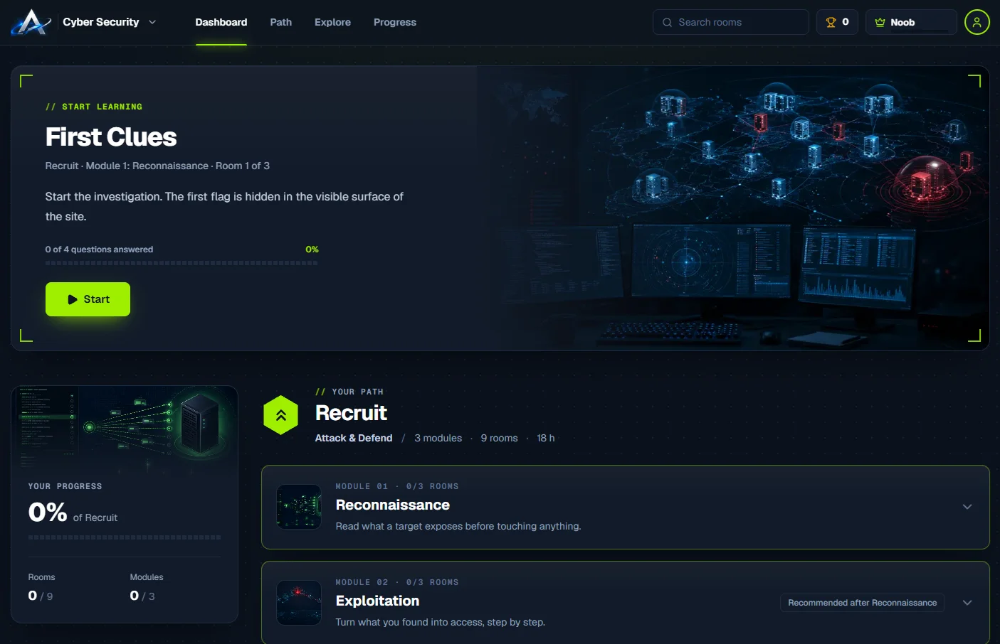

# Argos Security Arena

A cybersecurity training and benchmark platform, designed first for AI agents, then for people. Same idea as TryHackMe: paths, modules, rooms, questions and flags.

**Status: paused.** The training interface exists and is tested. The agent benchmark, the backend and real lab machines are not built.



*This screenshot shows the redesign on the [`redesign-atlas`](https://github.com/JN13012/Lab_CTF/tree/redesign-atlas) branch, where the latest work is.*

## What exists

- **Paths:** an entry path, "Recruit", then six specializations, from offensive work to AI security.
- **Rooms:** questions and flags, unlocked one after another in each module.
- **Progress:** points by difficulty, ranks, a dashboard and tracking, kept in the browser.
- **Areas:** cybersecurity, and AI as a preview.

## Planned, not built

- Evaluating AI pentest agents on scenarios whose flaws are known.
- Scores, a trace of every action and leaderboards.
- Isolated environments, reset after every run.

## Stack

React · Vite · Tailwind CSS · JavaScript · Node test runner

## Run it

```bash
npm ci
npm run dev
```
